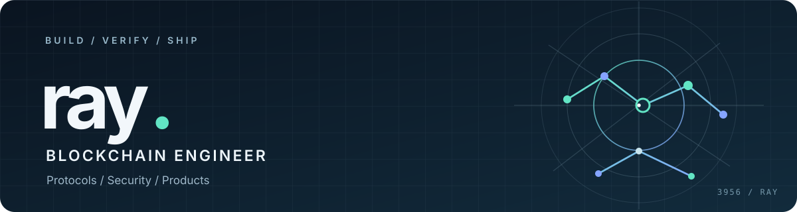

  

  <h1>Hi, I'm Ray (睿).</h1>
  
<strong>Smart Contract Developer</strong>

  
Solidity / EVM · Solana · Sui &nbsp;|&nbsp; Protocol Engineering · Security

  

    <a href="#selected-work">Selected Work</a> ·
    <a href="#background">Background</a> ·
    <a href="#engineering-approach">Approach</a> ·
    <a href="#connect">Connect</a>
  

I build **smart contracts and cross-chain systems** with an emphasis on clear trust boundaries, reproducible tests, and reliable state transitions. I also enjoy taking products from an idea to something people can actually use.

Previously a Blockchain Engineer at **Orderly Network**, working on EVM contracts and Solana / Sui integrations. MSc in Computer Science from **South China University of Technology** (2026), with graduate research in cryptography and blockchain.

---

## Selected Work

### Smart contracts & protocols

**[MealForward · 留膳](https://github.com/3956ray/MealForward)** · *Onchain escrow / social impact*

Prepaid meals funded by donors, claimed through vouchers, and redeemed by merchants. A smart-contract-backed workflow with separated roles and settlement controls. **In development and testnet testing; not a live payment service.**

<code>Solidity</code> · <code>Monad Testnet</code> · <code>TypeScript</code>

**[VC-DVN](https://github.com/3956ray/VC-DVN)** · *Cross-chain verification / MSc research*

Independent research prototype exploring aggregated verification-state compression for LayerZero V2 DVNs targeting Solana. Academic PoC, not a production or official LayerZero implementation.

<code>Rust</code> · <code>Solana</code> · <code>Anchor</code>

**[Solana AMM](https://github.com/3956ray/solana-amm)** · *DeFi protocol*

Constant-product AMM with liquidity operations, token swaps, a TWAP oracle, and protocol-fee accounting.

<code>Rust</code> · <code>Anchor</code> · <code>DeFi</code>

### Products & tools

**[ButtonPost](https://github.com/3956ray/ButtonPost)** · [buttonpost.app](https://buttonpost.app) · *Open-source product*

Write once, publish across multiple platforms. A web-first tool with connected accounts, per-platform publication results, and controlled retries.

<code>TypeScript</code> · <code>Next.js</code> · <code>Supabase</code>

**[Myself](https://github.com/3956ray/Myself)** · *Agent-native personal OS*

An evidence-first framework for personal knowledge, decisions, and experiments, built around local Markdown and human-controlled AI workflows.

<code>Python</code> · <code>Obsidian</code> · <code>AI agents</code>

Other projects: [FrisbeeDAO](https://github.com/3956ray/FrisbeeDAO) · [Agent delivery workflow](https://github.com/3956ray/Leader) ([ProductManager](https://github.com/3956ray/ProductManager) / [Developer](https://github.com/3956ray/Developer)) · [unioinpayIntl](https://github.com/3956ray/unioinpayIntl)

---

## Background

**Orderly Network** — Blockchain Engineer · Oct 2025 – Sep 2026

EVM smart contracts, cross-chain integrations, and engineering work involving Solana and Sui, with attention to contract testing and failure handling.

**South China University of Technology** — MSc, Computer Science · 2026

Research interests: cryptography, blockchain systems, and cross-chain verification protocols.

## Engineering Approach

- **Security starts with the threat model.** Define trust boundaries, permissions, and adversarial paths before relying on a happy-path demonstration.
- **Tests are evidence, not decoration.** Focus on state transitions, failure modes, edge cases, and reproducible verification.
- **Shipping means the whole system.** Contracts, integrations, backends, and usable interfaces all need to agree.
- **AI accelerates work; it doesn't validate it.** Agent-produced code and analysis still require independent review.

## Toolbox

**Smart contracts & chains:** Solidity · Foundry · EVM · Solana / Anchor · Sui · LayerZero

**Languages & infrastructure:** Rust · Go · TypeScript · Python · PostgreSQL · Docker

**Exploring:** smart-contract auditing, AI-agent engineering, onchain payments (x402), and agent identity (ERC-8004).

## Connect

I'm interested in **remote / async-friendly opportunities** involving smart contracts, protocol infrastructure, and security-conscious engineering.

**GitHub:** [@3956ray](https://github.com/3956ray) · **Product:** [ButtonPost](https://buttonpost.app)

<!-- Add a public contact email or professional social link only when ready. -->
